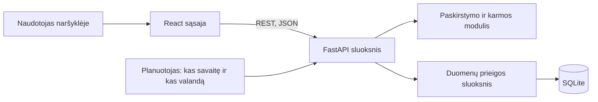

# ChoreKarma

Kursinio darbo I dalis: projektavimo dokumentas

## 1. Problema ir idėja

**Sistema vienu sakiniu:** Sistema skirta kartu gyvenantiems žmonėms, ši sistema paskirsto darbus pagal jų sunkumą ir taip pat seka, kas kiek padarė.

**Problema ir dabartinis procesas:** Dabar žmonės dalinasi darbais žodžiu, grupės pokalbyje ar kitais paprastais būdais. Dažnai naudojama rotacija - kas savaitę darbai pasislenka kitam. Ši rotacija neatsižvelgia į darbų sunkumą - grindų plovimas yra daug sunkesnis negu šiukšlių išnešimas. Taip pat kai žmogus išvyksta ar dėl kitų priežasčių negali atlikti darbų, reikia pačiam sekti, kas ką praleido, dėl ko gali kilti ginčai.

**Nauda:** 
- Darbai bus skirstomi pagal taškus, kas leis grupei žmonių atlikti panašų darbo kiekį.
- Praleistas darbas automatiškai perduodamas kitam žmogui, o darbą praleidęs asmuo gauna baudą.
- Galimybė apsikeisti darbais, o taškai atitenka darbą atlikusiam žmogui.
- Visi asmenys gali matyti atliktus darbus ir surinktus taškus, todėl sumažėja ginčai.

**Naudotojai:**
- Gyventojas: mato savo darbus, pažymi atliktus, siūlo ir priima mainus, nurodo, kada nebus namie.
- Administratorius (vienas iš gyventojų): sukuria namų ūkį, prideda gyventojus, darbus, nustato darbų taškus ir dienas.

**Prielaidos:**
- Namų ūkyje gyvena 2 ar daugiau žmonių.
- Darbų taškus nustato patys gyventojai. Sistema jų nevertina.
- Gyventojai patys sąžiningai pažymi atliktus darbus. Atlikimas netikrinamas.
- Savaitė prasideda pirmadienį, visi laikai skaičiuojami viena laiko juosta.
- Daroma prielaida, kad taškų sistema bus priimtinesnė už paprastą rotaciją.

## 2. Apimtis

| Funkcija | Ką naudotojas galės atlikti | Pagrindinis modulis ar pagalbinė funkcija |
|---|---|---|
| Namų ūkio valdymas | Administratorius prideda gyventojus ir darbus su taškais ir dienomis. Gyventojai pažymi dienas, kai nebus namuose. | Pagalbinė funkcija |
| Savaitės darbų paskirstymas | Sistema kiekvieną pirmadienį paskirsto darbus. Gyventojas mato savo savaitės darbų sąrašą. | Pagrindinis modulis |
| Darbo atlikimas ir baudos | Gyventojas pažymi darbą atliktu ir gauna taškus. Praleidus terminą skiriama bauda, o darbas perduodamas kitam. | Pagrindinis modulis |
| Darbų mainai | Gyventojas pasiūlo savo darbą kitam. Kitas priima arba atmeta. | Pagrindinis modulis |
| Karmos suvestinė | Visi mato kiekvieno surinktus taškus, tikslinę dalį ir balansą. | Pagalbinė funkcija |

**Į kursinio darbo apimtį neįeina:** mobilioji programėlė, tikri pranešimai, registracija, keli namų ūkiai vienam naudotojui, darbų atlikimo tikrinimas nuotraukomis, bendrų išlaidų skaičiavimas.

## 3. Pagrindinis modulis

**Pavadinimas ir atsakomybė:** Paskirstymo ir karmos modulis. Paskirsto savaitės darbus, taiko baudas už praleistus darbus, tikrina mainus, skaičiuoja kiekvieno gyventojo karmos balansą.

**Logika, kurią reikės projektuoti ir testuoti:** 

- Tikslinės dalies skaičiavimas, kai kas nors dalį mėnesio nebūna namuose.
- Darbų paskirstymas pagal balansą, buvimą ir nebuvimą namuose ir rotacijos ribą.
- Termino tikrinimas, baudos skyrimas ir darbo perskyrimas.
- Mainų taisyklių tikrinimas
- Mėnesio balanso skaičiavimas ir perkėlimas į kitą mėnesį.

**Įvestis:** 

- gyventojai ir jų nebuvimo dienos;
- savaitės darbai: pavadinimas, taškai, diena;
- ankstesnių savaičių priskyrimai ir surinkti taškai;
- įvykiai: darbas pažymėtas atliktu, mainų pasilymas, mainų atsakymas;
- dabartinis laikas.

Pavyzdys: Ana, Benas ir Darius. Visi namuose bus visą savaitę. Visų balansai 0. Savaitės darbai, kuriuos reikia paskirstyt:

| Darbas | Taškai | Diena |
|---|---|---|
| Vonios valymas | 5 | Sekmadienis |
| Virtuvės valymas | 3 | Šeštadienis |
| Siurbimas | 3 | Šeštadienis |
| Šiukšlės | 1 | Antradienis |
| Šiukšlės | 1 | Penktadienis |

Savaitės suma 13 taškų, mėnesio (4 savaitės) - 52 taškai

**Išvestis:** darbų priskyrimai, kiekvieno gyventojo balansas ir pranešimai apie situacijas, kurių nepavyko išspręsti.

Pavyzdys: Ana - Vonios valymas. Benas - Virtuvės valymas ir Šiukšlės (antradienis). Darius - Siurbimas ir Šiukšlės (penktadienis). Planuojami taškai: Ana 5, Benas 4, Darius 4.

**Veikimo eiga:**

1. Pirmadienį 00:00 modulis gauna savaitės darbus ir gyventojų būseną.
2. Apskaičiuoja kiekvieno gyventojo tikslinę dalį ir balansą.
3. Surikiuoja darbus nuo sunkiausio ir po vieną priskiria pagal taisykles.
4. Savaitės metu apdoroja įvykius: atliktus darbus ir mainus.
5. Kas valandą tikrina terminus ir taiko baudas.
6. Mėnesio pabaigoje suskaičiuoja galutinius balansus ir perkelia juos į kitą mėnesį.

### Taisyklės arba sprendimo žingsniai

1. **Tikslinė dalis.** Gyventojo tikslinė dalis = mėnesio darbų taškų suma × (jo dienos namuose / visų gyventojų dienų namuose suma).
2. **Balansas.** Balansas = surinkti taškai (su baudomis) + šią savaitę priskirtų darbų taškai + perkeltas balansas - tikslinė dalis už praėjusias savaites.
3. **Paskirstymas.** Darbai rikiuojami pagal taškus mažėjančiai, po to pagal dieną. Kiekvienas darbas skiriamas gyventojui, kuris tą dieną yra namuose ir kurio balansas mažiausias. Jei balansai lygūs, renkamas tas, kuris šį darbą darė seniausiai (kas nedarė niekada - pirmas). Jei ir tai lygu, renkama pagal abėcėlę.
4. **Rotacija.** Gyventojas negauna to paties darbo trečią savaitę iš eilės, jei yra kitas tinkamas kandidatas.
5. **Nėra kandidato.** Jei darbo dieną namuose nėra nė vieno gyventojo, darbas gauna būseną „Nepaskirtas". Taškai ir baudos neskiriami, visi gauna įspėjimą.
6. **Praleistas darbas.** Jei darbas nepažymėtas atliktu per 24 val. po termino, gyventojas gauna baudą: minus pusė darbo taškų, apvalinant į didesnę pusę. Darbas perskiriamas pagal 3 taisyklę be praleidusio gyventojo, naujas terminas - po 48 val. Kas jį atlieka, gauna darbo taškus ir 1 premijos tašką.
7. **Mainai.** Gyventojas gali pasiūlyti savo darbą kitam arba pasiūlyti apsikeisti darbais. Mainai galioja tik jei kitas sutinka, jis tą dieną yra namuose, o iki termino liko ne mažiau nei 24 val. Taškai visada priklauso tam, kas darbą atliko.
8. **Mėnesio pabaiga.** Galutinis balansas = surinkti taškai - tikslinė dalis. Jis perkeliamas į kitą mėnesį, bet ne daugiau nei ±10 taškų.

### Scenarijai būsimiems testams

| Scenarijus | Pradinės sąlygos ir konkreti įvestis | Veiksmas | Tikslus laukiamas rezultatas |
|---|---|---|---|
| Įprastas atvejis | Ana, Benas, Darius visi namuose. Pirma mėnesio savaitė, balansai 0. Darbai kaip įvesties pavyzdyje. | Paleidžiamas savaitės paskirstymas. | Ana: Vonios valymas (5). Benas: Virtuvės valymas (3), Šiukšlės antr. (1). Darius: Siurbimas (3), Šiukšlės penkt. (1). Planuojami taškai 5 / 4 / 4. |
| Konfliktas: praleistas darbas | Paskirstymas kaip 1 scenarijuje. Visi kiti darbai atlikti. Beno Virtuvės valymo terminas šeštadienis 20:00, darbas nepažymėtas. | Sekmadienį 20:01 tikrinami terminai. | Benas gauna -2 baudą. Darbas perskiriamas Dariui (jo balansas 4, Anos 5), terminas antradienis 20:00. Darius atlieka ir gauna 3 + 1. Balansai: Ana 5, Benas -1, Darius 8. |
| Ribinis atvejis: nebuvimas | Mėnuo 28 dienų, darbų suma 52 taškai. Darius išvyksta 14 dienų. | Skaičiuojamos tikslinės dalys. | Ana 20,8, Benas 20,8, Darius 10,4 taško. Tomis 14 dienų Darius nėra kandidatas jokiam darbui. |
| Ribinis atvejis: mainai | Ana turi Vonios valymą (5, sekmadienis), Darius - Siurbimą (3, šeštadienis). Dabar trečiadienis 12:00. | Ana siūlo apsikeisti, Darius sutinka. | Mainai priimti. Ana daro Siurbimą, Darius - Vonios valymą. Atlikus darbus Ana gauna 3, Darius 5 taškus. |
| Klaida: per vėlyvi mainai | Ana turi Vonios valymą, terminas sekmadienis 20:00. Dabar sekmadienis 10:00. | Ana siūlo darbą Benui. | Pasiūlymas atmestas su pranešimu „Iki termino liko mažiau nei 24 val.". Priskyrimas nesikeičia. |
| Klaida: nėra kandidato | Penktadienį Ana, Benas ir Darius pažymėti kaip ne namuose. | Paleidžiamas savaitės paskirstymas. | Šiukšlės (penktadienis) gauna būseną „Nepaskirtas". Taškai ir baudos neskiriami, visiems rodomas įspėjimas. Kiti darbai paskirstomi įprastai. |

**Jei modulis naudoja AI:** Netaikoma.

## 4. Kokybės atributas

**Pasirinktas atributas:** Palaikomumas (modifikuojamumas).

**Kodėl svarbus šiai sistemai:** Kiekvienas namų ūkis turi savo susitarimų. Vieniems reikia griežtesnių baudų, kitiems - ribos, kiek darbų galima gauti per dieną. Naujas taisykles turi būti lengva pridėti ir nesugadinti esamų.

**Tikrinimo scenarijus ir sąlygos:** Kai visi 3 skyriaus scenarijai jau veikia ir yra padengti testais, pridedama nauja taisyklė: „Gyventojas negauna daugiau nei 2 darbų tą pačią dieną".

**Sėkmės kriterijus:** 

- Nauja taisyklė pridedama kaip nauja klasė ir viena registracijos eilutė.
- Esamų taisyklių klasėse pakeitimų nėra (tikrinama per `git diff`).
- Visi ankstesni testai praeina be pakeitimų.
- Naujai taisyklei parašytas bent vienas testas, ir jis praeina.

**Numatytas projektavimo sprendimas:** Kiekviena taisyklė yra atskira klasė, kuri įgyvendina bendrą sąsają (strategijos šablonas). Yra trys taisyklių tipai: kandidatų filtras (pvz., buvimas namuose, rotacija), prioriteto taisyklė (balansas, lygybių sprendimas) ir baudos politika. Paskirstymo variklis taiko taisyklių sąrašą nustatyta tvarka ir nežino konkrečių taisyklių.

**Kaip patikrinsiu vėlesniame etape:** Parodysiu pakeitimo demonstraciją: atskirą „commit" su nauja taisykle, `git diff` rezultatą ir visų testų paleidimą.

**Sprendimo kaina arba ribojimas:** Daugiau klasių ir sudėtingesnė struktūra nei viena funkcija. Taisyklių tvarka turi įtakos rezultatui, todėl ją reikės aiškiai dokumentuoti ir testuoti.

### Antras atributas

**Pasirinktas atributas:** Teisingumas (sąžiningas paskirstymas).

**Kodėl svarbus šiai sistemai:** Visa sistemos vertė - kad darbai pasiskirsto tolygiai. Jei balansai nuolat skiriasi, naudotojai sistema nepasitikės.

**Tikrinimo scenarijus ir sąlygos:** Simuliuojami 12 mėnesių. 3 gyventojai, 13 taškų darbų per savaitę. Kiekvieną dieną kiekvienas gyventojas yra namuose su 80 % tikimybe. Praleistų darbų nėra. Naudojama fiksuota atsitiktinių skaičių sėkla, kad rezultatą būtų galima pakartoti.

**Sėkmės kriterijus:** Ne mažiau nei 11 iš 12 mėnesių pabaigoje skirtumas tarp didžiausio ir mažiausio balanso yra ne didesnis nei 5 taškai (didžiausio darbo vertė).

**Numatytas projektavimo sprendimas:** Darbas visada skiriamas mažiausią balansą turinčiam gyventojui, pradedant nuo sunkiausių darbų. Balansas perkeliamas į kitą mėnesį, todėl skirtumai išsilygina.

**Kaip patikrinsiu vėlesniame etape:** Simuliacijos skriptas, kuris tiesiogiai kviečia pagrindinį modulį ir išveda kiekvieno mėnesio balansų skirtumą.

**Sprendimo kaina arba ribojimas:** Godus algoritmas negarantuoja geriausio paskirstymo. Rotacijos taisyklė ir nebuvimo dienos gali padidinti skirtumus.

## 5. Pradinė sistemos struktūra

### Paprasta schema

| Sistemos dalis | Atsakomybė |
|---|---|
| React sąsaja | Rodo savaitės darbus, mainų pasiūlymus ir karmos suvestinę. Siunčia naudotojo veiksmus į API. |
| FastAPI sluoksnis | Priima užklausas, įkelia duomenis per duomenų prieigos sluoksnį, kviečia pagrindinį modulį ir išsaugo rezultatą. |
| Paskirstymo ir karmos modulis | Visa verslo logika: taisyklės, paskirstymas, baudos, mainai, balansai. Nežino apie duomenų bazę ir HTTP, todėl lengvai testuojamas. |
| Duomenų prieigos sluoksnis | Skaito ir rašo gyventojus, darbus, priskyrimus, mainus ir taškų įrašus. |
| SQLite | Saugo visus duomenis viename faile. |
| Planuotojas | Pirmadienį 00:00 paleidžia savaitės paskirstymą, kas valandą - terminų tikrinimą. Prototipe tai bus ir mygtukas, kad būtų galima parodyti be laukimo. |

**Planuojamos technologijos ir pasirinkimo priežastys:** 

- **Python 3.12** - pagrindinis modulis bus paprastas Python paketas be išorinių priklausomybių, todėl jį lengva testuoti.
- **pytest** - testams pagal 3 skyriaus scenarijus.
- **FastAPI** - greitai sukuriamas REST API su automatine dokumentacija.
- **SQLite su SQLAlchemy** - nereikia atskiro serverio, prototipui pakanka.
- **React (Vite)** - paprasta sąsaja keliems puslapiams.
- Laikas modulyje bus gaunamas per atskirą laikrodžio sąsają. Testuose bus naudojamas fiksuotas laikas.

## 6. AI panaudojimas

### AI rengiant šį dokumentą

Naudojau AI.

| Priemonė ir užduotis | Ką panaudojau | Ką atmečiau arba perrašiau ir kodėl | Kaip patikrinau |
|---|---|---|---|
| Claude (Anthropic) - idėjų generavimas | Paprašiau kelių projektų idėjų sąrašų. Pasirinkau buities darbų paskirstymo su taškais idėją. | Atmečiau kelis pirmus sąrašus (pamainų planavimas, rezervacijos, kainų skaičiavimas), nes jie per daug standartiniai ir man neįdomūs. | Palyginau idėją su užduoties reikalavimais: ar yra verslo logikos, ne tik CRUD, ar galima parašyti bent 3 patikrinamas taisykles. |

### Planuojamas AI naudojimas kuriant sistemą

**Kur ir kam naudosiu AI:** Pagalbiniam kodui (FastAPI maršrutai, React formos, SQLAlchemy modeliai), papildomų testų atvejų idėjoms ir kodo peržiūrai. Pagrindinio modulio taisykles rašysiu pats.

**Kaip tikrinsiu pasiūlymus ir sugeneruotą kodą:** Kiekvieną pakeitimą peržiūrėsiu prieš „commit". Nepriimsiu kodo, kurio negaliu paaiškinti. Visas kodas turi praeiti esamus testus. AI pasiūlytus testų atvejus perskaičiuosiu ranka, prieš įtraukdamas.

**Ar AI bus sistemos funkcionalumo dalis:** Ne

## 7. Tolesnių darbų planas

| Darbas | Apčiuopiamas rezultatas | Planuojama darbų seka |
|---|---|---|
| Pagrindinis modulis | Python paketas su taisyklių klasėmis ir pytest testais visiems 3 skyriaus scenarijams. | 1 |
| Sąžiningumo simuliacija | Skriptas, kuris paleidžia 12 mėnesių simuliaciją ir išveda balansų skirtumus. | 2 |
| Duomenų saugojimas ir API | SQLite schema, duomenų prieigos klasės ir FastAPI galiniai taškai: paskirstyti savaitę, pažymėti atlikimą, mainai, suvestinė. | 3 |
| Sąsaja | React puslapiai: savaitės darbai, mainų pasiūlymai, karmos suvestinė. | 4 |
| Palaikomumo demonstracija | Atskiras „commit" su nauja taisykle ir visų testų paleidimas. | 5 |

**Būsimo prototipo veikimo scenarijus:** Sukuriu namų ūkį su Ana, Benu ir Darium bei 5 darbais iš 3 skyriaus pavyzdžio. Paspaudžiu „Paskirstyti savaitę" ir tikiuosi rezultato kaip 1 scenarijuje (5 / 4 / 4 taškai). Tada Beno Virtuvės valymą paliekame nepažymėtą ir paleidžiu terminų tikrinimą. Tikiuosi, kad Benas gaus -2 baudą, o darbas atiteks Dariui. Galiausiai parodau karmos suvestinę su atnaujintais balansais.

| Rizika arba neaiškumas | Kaip patikrinsiu arba sumažinsiu |
|---|---|
| Godus paskirstymas su rotacijos ir nebuvimo taisyklėmis gali neduoti tolygaus rezultato. | Simuliaciją paleisiu iškart po pagrindinio modulio. Jei kriterijus nepasiekiamas, keisiu taisyklių tvarką arba rotacijos ribą. |
| Laiko logika (terminai, 24 val. riba, mainų riba) sunkiai testuojama. | Laikrodis bus perduodamas moduliui kaip priklausomybė. Testuose naudosiu fiksuotą laiką ir atskirai patikrinsiu ribas (lygiai 24 val., 1 min. per vėlai). |
| Mainais galima nuolat atiduoti sunkius darbus kitiems. | Taškai visada atitenka atlikusiam, todėl balansas tai kompensuoja. Patikrinsiu atskiru testu: po kelių tokių mainų atiduodančiojo balansas mažėja, ir jam skiriami sunkesni darbai. |

## Šaltiniai, jei naudojote

Išorinių šaltinių nenaudojau.